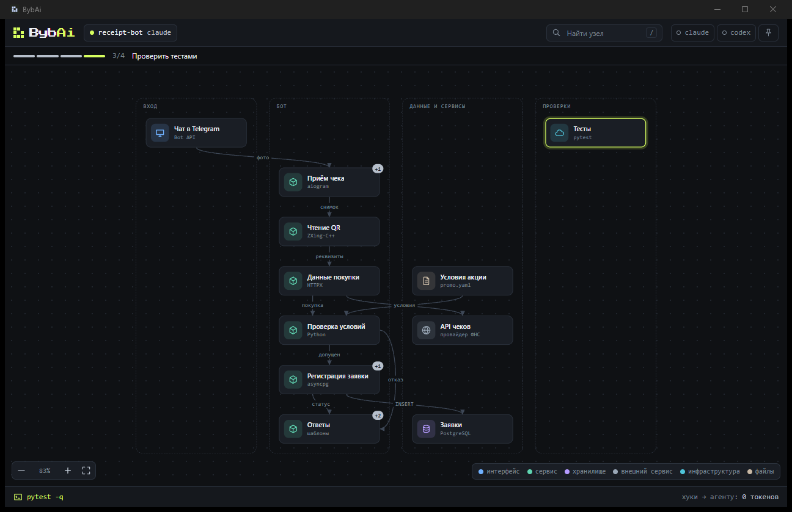
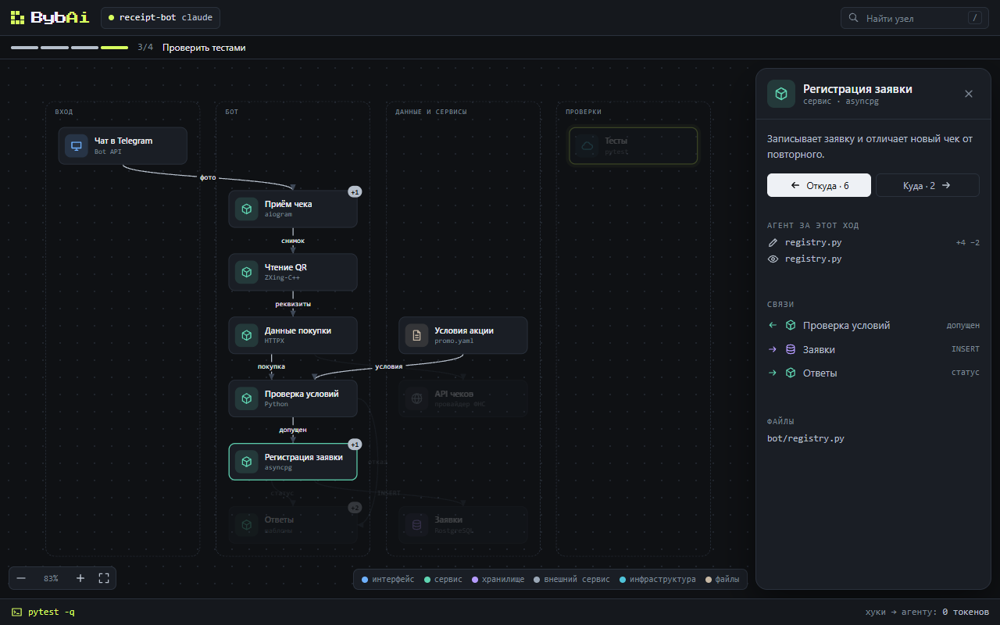
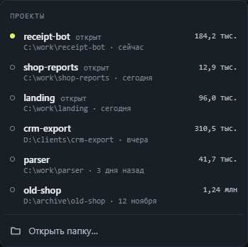
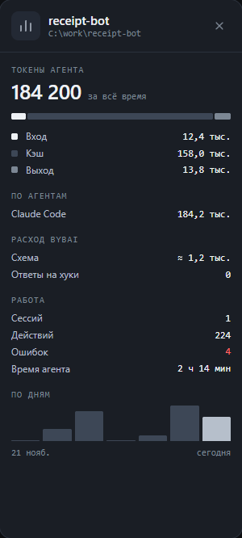
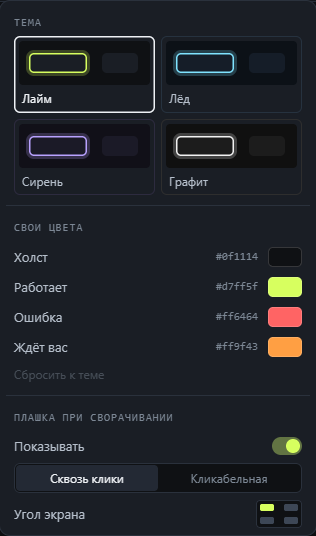
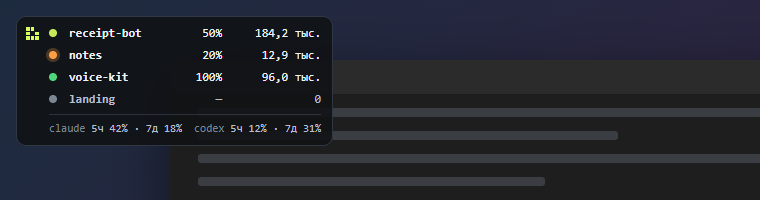
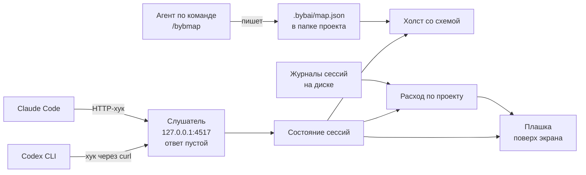

<div align="center">

# ΒybAi

**Карта проекта, на которой видно, что агент делает прямо сейчас**

Окно рядом с терминалом для Claude Code и Codex CLI<br>
Windows · Tauri 2 · Preact · Rust



</div>

## Зачем

Агент в терминале пишет много и быстро: что он трогает и где находится в проекте, из потока текста не видно. ΒybAi показывает это картинкой.

- Агент один раз рисует **схему архитектуры** проекта: компоненты, связи, границы.
- Пока он работает, на схеме **светится узел**, чьи файлы он читает или правит.
- Свернули окно — в углу экрана остаётся **светофор**: работает, ждёт вас или готов.

Модели это почти ничего не стоит: живая подсветка идёт через хуки с пустым ответом, а схема — около тысячи токенов за один раз.

## Что умеет

### Схема и живая подсветка

Узел светится, пока агент читает или правит его файлы или запускает его команды. Метка в углу показывает число правок за ход, ошибку или ожидание вашего ответа. Над холстом — план агента одной строкой; полный список шагов открывается по щелчку.

Щелчок по узлу открывает карточку: описание, связи, файлы и то, что агент сделал с узлом за ход. «Откуда» и «Куда» подсвечивают всю цепочку до узла и после него.



### Проекты, статистика, настройки

<table>
<tr>
<td width="36%" valign="top">

**Проекты во вкладках**

Вкладка — проект, а не сессия. Кнопка «+» открывает любой проект, в котором агенты работали раньше, или папку без сессии.



</td>
<td width="32%" valign="top">

**Расход по проекту**

Сколько токенов агенты потратили на проект: вход, кэш и выход, по агентам, по дням. Отдельно — сколько стоил сам ΒybAi.



</td>
<td width="32%" valign="top">

**Темы и свои цвета**

Четыре темы и свои цвета поверх любой из них. Здесь же настраивается плашка.



</td>
</tr>
</table>

### Плашка поверх экрана

Пока окно свёрнуто, в углу экрана висит маленькая плашка: строка на проект. По умолчанию клики проходят сквозь неё; в настройках её можно сделать кликабельной и выбрать угол.



| Фонарь | Что значит |
|---|---|
| серый | работа не начата |
| мигающий лаймовый | агент работает |
| оранжевый | ошибка или нужно ваше подтверждение |
| зелёный | готово |

Рядом с фонарём — процент выполненных шагов плана и токены проекта. Нижняя строка показывает расход подписки; если агент работает по API, её нет.

## Сколько это стоит агенту

| Что | Токены модели |
|---|---|
| Живая подсветка | 0: на хуки окно отвечает пустым ответом |
| Схема проекта | около 1 тыс. за раз: правила и записанный файл |
| Расход и статистика | 0: окно читает журналы сессий с диска |
| Строка состояния Claude Code | 0: рисуется в терминале, модели не достаётся |

Нижняя строка окна показывает эти счётчики по выбранному проекту.

## Как это работает



- **Хуки.** Оба агента умеют сообщать внешней программе о своих действиях. ΒybAi слушает их на `127.0.0.1:4517` и отвечает пустым ответом, поэтому в контекст модели ничего не попадает.
- **Схема.** Лежит в папке проекта, в `.bybai/map.json`. У каждого узла указаны шаблоны его файлов: по ним окно понимает, какой узел подсветить. Схему вы заказываете командой `/bybmap` в Claude Code или `$bybmap` в Codex. Это навык, который агент сам вызвать не может, поэтому до вашей команды он не занимает контекст.
- **Расход.** Окно читает журналы сессий, которые агенты сами пишут на диск (`~/.claude/projects`, `~/.codex/sessions`). Расход подписки Codex лежит там же. Claude Code отдаёт его только своей строке состояния, поэтому, пока ΒybAi открыт, в терминале Claude Code внизу стоит строка вида «5ч 42% · 7д 18%».

## Быстрый старт

1. Соберите и запустите окно (см. ниже) и включите в верхней полосе `claude` или `codex`.
2. **Claude Code**: начните или продолжите сессию в папке проекта. **Codex**: один раз выполните в нём `/hooks` и подтвердите хуки ΒybAi, без этого он их не запускает.
3. Когда проект появится во вкладках, наберите в терминале агента `/bybmap` (в Codex `$bybmap`). Агент запишет `.bybai/map.json`, и схема появится в окне сама.
4. Работайте с агентом как обычно. Если в схеме нашлись ошибки, окно покажет их и даст готовый запрос на исправление.

Управление: колесо — масштаб, перетаскивание — сдвиг, `Esc` — снять фокус и закрыть панели. Колесо над вкладками листает их.

## Что ΒybAi меняет на компьютере

Всё, что окно кладёт в настройки агентов, существует, только пока оно открыто: при запуске ставится, при выходе убирается. Чужие хуки, навыки и настройки не трогаются.

| Где | Что | Когда убирается |
|---|---|---|
| `~/.claude/settings.json` | хуки и строка состояния (только если своей у вас нет) | при выходе |
| `~/.claude/skills/bybmap` | навык `/bybmap` | при выходе |
| `~/.codex/hooks.json` | хуки | при выходе |
| `~/.codex/skills/bybmap` | навык `$bybmap` | при выходе |
| `~/.bybai.json` | какие агенты включены | остаётся |
| `~/.bybai/` | настройки окна и статистика проектов | остаётся |
| `<проект>/.bybai/map.json` | схема; её пишет агент, а не окно | остаётся |

Перед первой правкой уже существующего файла настроек рядом сохраняется его копия с окончанием `.bybai-backup`. Если ΒybAi завершился аварийно, запустите его и закройте обычным образом: хуки будут убраны.

## Сборка

Нужны Node.js 22+, Rust и Microsoft C++ Build Tools.

```
npm install
npm run tauri dev                     окно в режиме разработки
npm run tauri build -- --no-bundle    готовый exe: src-tauri/target/release/bybai.exe
npm run tauri build                   установщик: src-tauri/target/release/bundle/nsis
npm test                              тесты модели, схемы и статистики
cargo test                            тесты слушателя, установки хуков и чтения журналов (в src-tauri)
```

## Демо без агентов

Откройте ΒybAi и проиграйте в него запись:

```
npm run replay -- fixtures/receipt-bot.jsonl --speed 4
```

Это синтетическая сессия Claude Code в демопроекте `fixtures/receipt-bot` со схемой бота для регистрации чеков. То же работает в браузере без окна: `npm run bridge` и `npm run dev` в двух терминалах, страница `http://127.0.0.1:5173`, затем та же команда.

## Что в репозитории

| Папка | Что там |
|---|---|
| `src/map/` | формат и проверка схемы, раскладка, значки, живая подсветка, правила навыка |
| `src/model/` | разбор хуков обоих агентов и состояние сессии |
| `src/stats.ts`, `src/settings.ts`, `src/data.ts` | статистика проектов, настройки окна, данные для окна и плашки |
| `src/ui/`, `src/App.tsx`, `src/Hud.tsx` | интерфейс на Preact: главное окно и плашка |
| `src-tauri/` | окна, слушатель, установка хуков, чтение расхода из журналов агентов |
| `design/` | токены и темы, стили, кадры окна, макеты, значок |
| `docs/` | устройство приложения, формат схемы, формат событий |
| `fixtures/`, `dev/` | демо-записи и инструменты разработки |

Подробнее: [устройство](docs/architecture.md), [формат схемы](docs/map.md), [события](docs/events.md).

## Состояние

Рабочая версия для Windows. Claude Code проверен вживую; поддержка Codex написана по его исходникам и ждёт живой проверки. Что сделано, что проверено и что осталось — в [STATUS.md](STATUS.md).

Сейчас поддерживается один тип схемы — архитектура. Схема не обновляется сама: когда проект изменился, дайте агенту команду ещё раз.

Шрифт логотипа — Press Start 2P, лицензия [OFL](design/fonts/OFL.txt).
